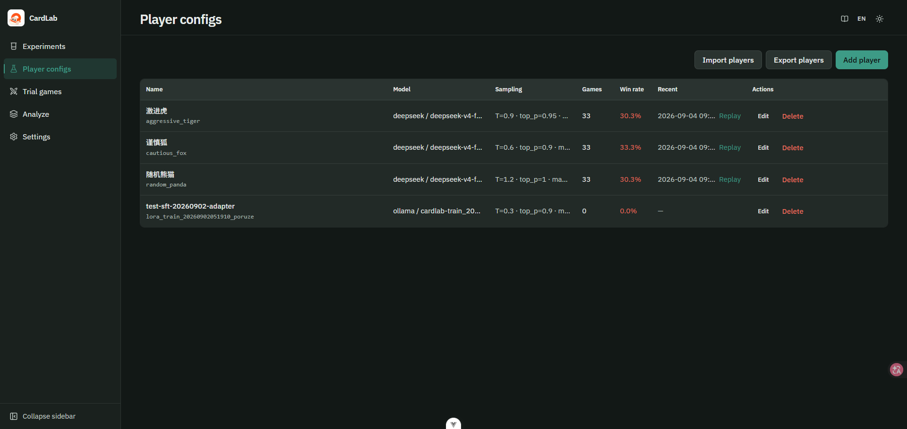
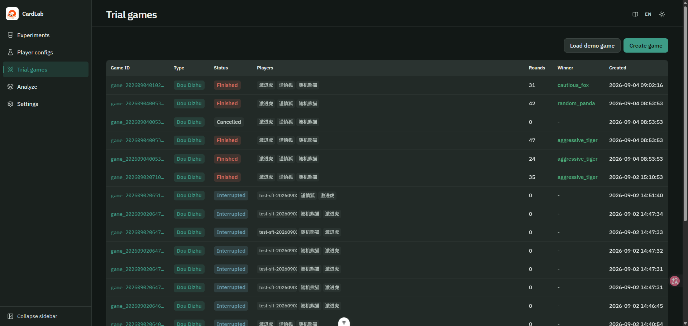
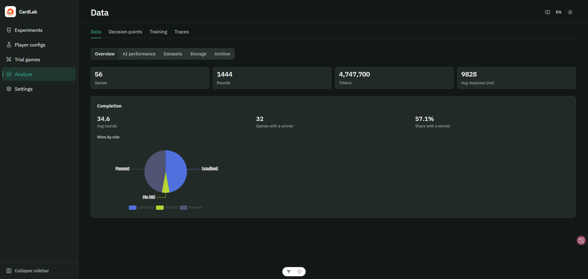
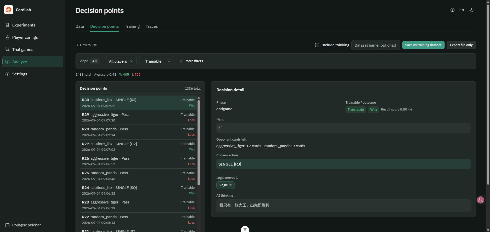
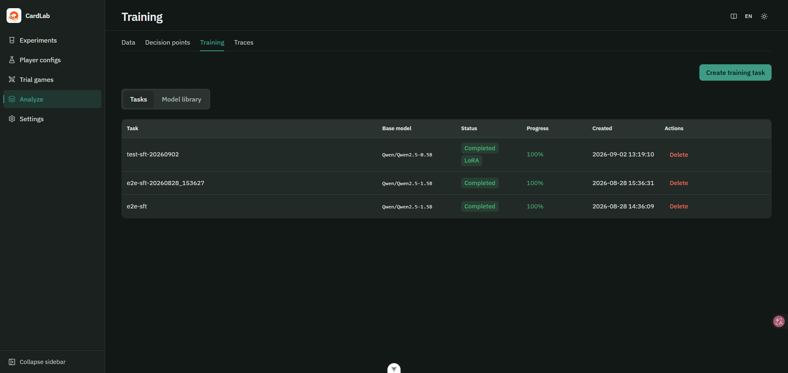
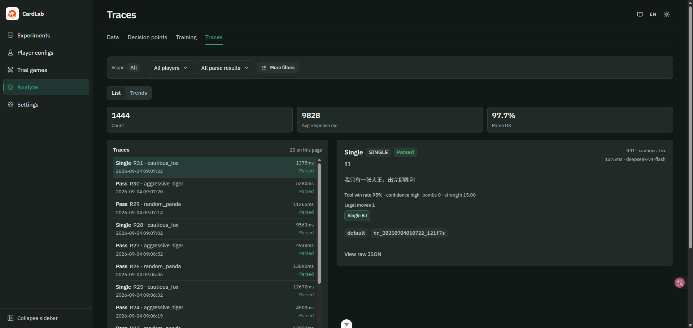

# CardLab

[中文](README.md) | English

Local AI card-game research tool: form hypotheses, inspect decisions, compare game results and record conclusions. LoRA fine-tuning is an optional improvement path.

After saving a comparison, cite individual decisions and append conclusion revisions with observations, interpretation and limitations. Export a research report containing the snapshot and selected evidence. Source changes or deletion do not rewrite saved evidence.

> **Models and data**: CardLab uses models configured by the user for card-playing decisions. It can export training data from recorded games and teacher–student preference pairs from the first verifiable action divergence in a paired deal. Check the provider's permissions for the intended use before reusing third-party model outputs. CardLab ships without model weights.

## Stack

The Windows desktop development build reuses this research workbench and bundles its Python backend. See the [desktop documentation](docs/desktop/README.md) for builds, scope and validation status. The development installer is unsigned; clean-machine release acceptance is still pending.

The desktop app supports native Save As for JSON and readable HTML reports, and can show saved files in their folders. It restores the main window's position, size and maximized state with the research location. The existing installer was built from an earlier revision. [Report export validation](specs/desktop-research-workspace/validation-4a.md) · [File location validation](specs/desktop-research-workspace/validation-5d.md) · [Layout restoration validation](specs/desktop-research-workspace/validation-5e.md)

The research expenses panel supports manual entries, OpenAI project cost snapshots, CSV reconciliation and limits on new tasks. Each amount reflects its source and scope. Validation against actual invoices and an enforceable spending cap are still pending. [Billing validation procedure](specs/desktop-research-workspace/billing-acceptance.md)

| Layer | Choice |
|-------|--------|
| Frontend | Vue 3 · TypeScript · Vite · Tailwind v4 · Reka UI |
| Backend | Python 3.11+ · FastAPI · WebSocket |
| LLM | OpenAI · Ollama · DashScope · DeepSeek · Kimi · Zhipu · Yi · Baichuan · MiniMax |
| Storage | SQLite index + JSONL archive |
| Training | PEFT LoRA (`poetry install --with training`; CPU quick check without GPU; optional 4-bit QLoRA needs bitsandbytes) |

## Quick start

**Requires**: Python 3.11+ · Node 20.19+ / 22.12+ · Poetry · (optional) Ollama

```bash
git clone https://github.com/blueWhalei/ai-card-game-lab.git
cd ai-card-game-lab
cp .env.example .env    # Windows: copy .env.example .env
```

Start in two terminals:

| Platform | Backend (:8000) | Frontend (:5173) |
|----------|-----------------|------------------|
| Windows | `scripts\start-backend.bat` | `scripts\start-frontend.bat` |
| macOS / Linux | `chmod +x scripts/*.sh` then `./scripts/start-backend.sh` | `./scripts/start-frontend.sh` |

Or manually: `cd server && poetry install && poetry run uvicorn ...` · `cd web && npm install && npm run dev`.

Open http://localhost:5173 . In **Create experiment**, choose **Try one offline game**, save, then confirm **Start experiment** on the run page. CardLab prepares three local players and plays one fixed deal without model credentials. For a model experiment, choose **Choose players** to add or select seats in the same dialog. Review the start conditions and use **Check model connection** to read the selected providers’ model catalogs.

Source development uses the project `.env`. The desktop app shows its `config.env` path in Settings. Restart the service after editing the file. **Load demo experiment** inserts prepared main/control data for exploring analysis. Importable packs live in [`examples/`](examples/).

Experiment notes and comparison conclusion drafts save automatically to the local database. Applying notes updates the experiment summary; publishing a formal conclusion remains an explicit action that freezes evidence in a new revision. Failed saves preserve input and offer retry, copy export and conflict resolution.

See the desktop research workspace [design](specs/desktop-research-workspace/design.md), [requirements](specs/desktop-research-workspace/requirements.md) and [delivery plan](specs/desktop-research-workspace/tasks.md). Directional support requires paired evidence, a difference interval, a test and protocol review; this exploratory assessment establishes neither general superiority nor equivalence.

## Main loop

1. **Start research and configure players** — record the research question on Home and choose models, policies and sampling parameters. A quick experiment creates research automatically.
2. **Define an experiment** — create a run in the research workspace, select players and record a hypothesis with evaluation criteria. Creation does not start games; copies and paired controls retain their research context.
3. **Run and review** — watch or replay games, then review all decisions, including failures and records excluded from training. Trainable means structurally valid; it does not measure decision quality.
4. **Compare** — compare existing experiments or create a control using registered players and source deal seeds. Check protocol differences and effective sample sizes before interpreting results.
5. **Record conclusions** — keep working notes on experiment detail; save a comparison snapshot, then cite decisions and append conclusion revisions under Conclusions and evidence.

**Optional training:** use Analyze → Training to export/register decision datasets, fine-tune and register a player. Training is not a prerequisite for review, comparison or control creation. Opening a control with `?collect=1` only opens start confirmation; games require an explicit submission.

Comparison now shows frozen protocol differences and effective shared seeds, excluding ambiguous duplicate runs. Declare allowed Solver changes and compare again. Save a named snapshot to reopen or export its frozen results later. Declarations are retrospective; research reports include selected evidence, while full runnable reproduction packages remain planned.

Home `/` is the research studio. `/research/:id` groups runs and comparison records; unassigned runs can be added explicitly. A comparison appears in research only when every included run belongs to it. Cross-research comparisons remain in the comparison library. Design Prompt A/B offers three steps: choose a fixed-deal baseline with a model player, change one phase’s prompt, and review frozen conditions. Creating B makes no model calls; start each run explicitly, then use the existing comparison and conclusion workflow. Configuration checks do not verify remote connectivity. See the [batch 2B design](specs/desktop-research-workspace/batch-2b.md). Linked analysis remains planned.

Benchmark mode uses fixed deal seeds (up to 50 games); the detail page shows **this run’s** metrics under the current phase (landlord WR, parse, trainable, latency, tokens/game). Trial games live at `/game` (not tied to experiments). Decisions, traces, data, and training are under **Analyze** (`/pipeline/…`, `?experiment_id=`). Export an experiment pack from detail (no API keys) and import it in All runs `/experiments` to reproduce on another machine. Usage guide: header book icon → `/guide`.

Script loop: `.\scripts\e2e_pipeline.ps1 all -Count 1` — see [E2E guide](docs/E2E_PIPELINE.md).

## Screenshots

<table>
  <tr>
    <td width="50%" valign="top">
      
      <p><strong>Player configs</strong> — model and sampling per seat; import / export packs. Packs do not include API keys.</p>
    </td>
    <td width="50%" valign="top">
      
      <p><strong>Trial games</strong> — one-off matches outside experiments; or load a demo and watch.</p>
    </td>
  </tr>
  <tr>
    <td width="50%" valign="top">
      
      <p><strong>Analyze · Data</strong> — corpus size, completion, landlord / peasant win split.</p>
    </td>
    <td width="50%" valign="top">
      
      <p><strong>Analyze · Decisions</strong> — state, legal moves, thinking, train-usable; export ChatML.</p>
    </td>
  </tr>
  <tr>
    <td width="50%" valign="top">
      
      <p><strong>Analyze · Training</strong> — PEFT LoRA tasks and the model repo; register a finished tag as a player.</p>
    </td>
    <td width="50%" valign="top">
      
      <p><strong>Analyze · Traces</strong> — latency, parse rate, tool calls, raw JSON.</p>
    </td>
  </tr>
</table>

## Config

`.env` at repo root:

```bash
DEEPSEEK_API_KEY=sk-...
DEEPSEEK_BASE_URL=https://api.deepseek.com/v1
# or OPENAI_API_KEY / OLLAMA_BASE_URL=http://localhost:11434
```

| provider | example model |
|----------|----------------|
| `openai` | `gpt-4o-mini` |
| `deepseek` | `deepseek-v4-flash` |
| `ollama` | `qwen2.5:7b` |
| `dashscope` | `qwen-plus` |

## Links

| URL | |
|-----|---|
| https://blueWhalei.github.io/ai-card-game-lab/en/ | Project page |
| http://localhost:5173 | UI |
| http://localhost:8000/docs | API docs |
| http://localhost:8000/api/v1/system/preflight | Preflight (run-ready) |

## Docs

| Doc | |
|-----|---|
| [E2E pipeline](docs/E2E_PIPELINE.md) | Collect → train → deploy |
| [Architecture](docs/ARCHITECTURE.md) | Layers and flows |
| [API design](docs/API_DESIGN.md) | REST + WebSocket |
| [Project structure](docs/PROJECT_STRUCTURE.md) | Directory map |
| [Coding standards](docs/CODING_STANDARDS.md) | Python / Vue / i18n |
| [Examples](docs/EXAMPLES.md) | New engine / provider |
| [CLAUDE.md](CLAUDE.md) | Agent entry |

## License

[MIT](LICENSE)
