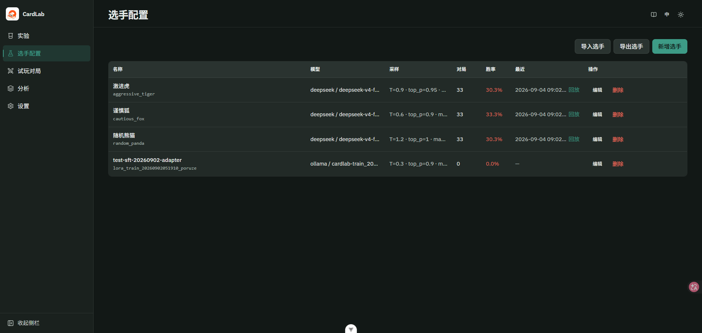
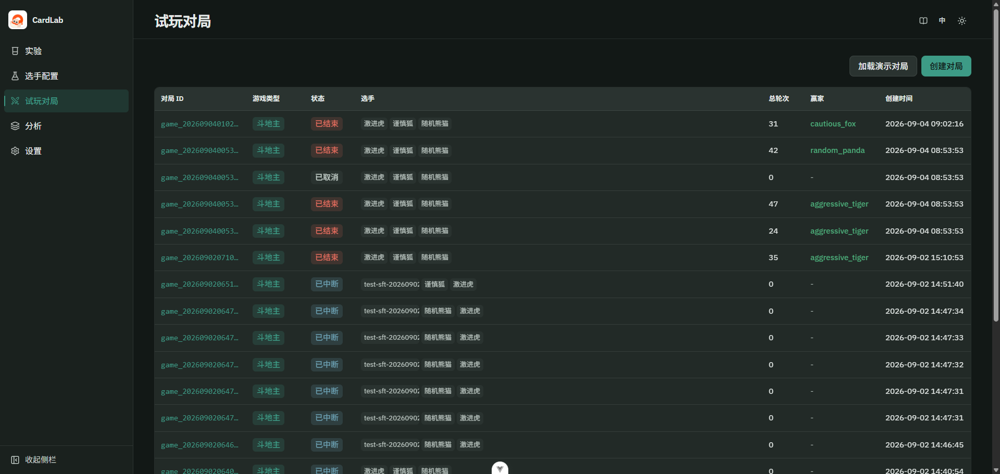
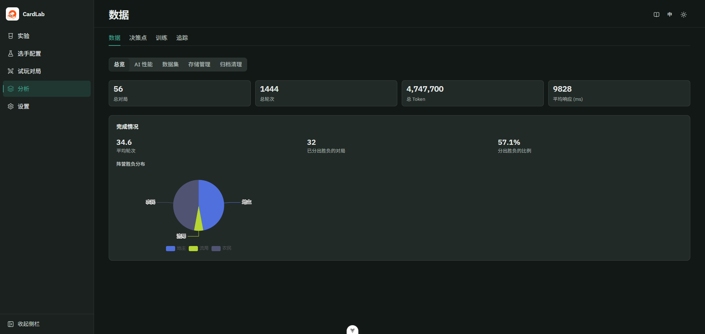
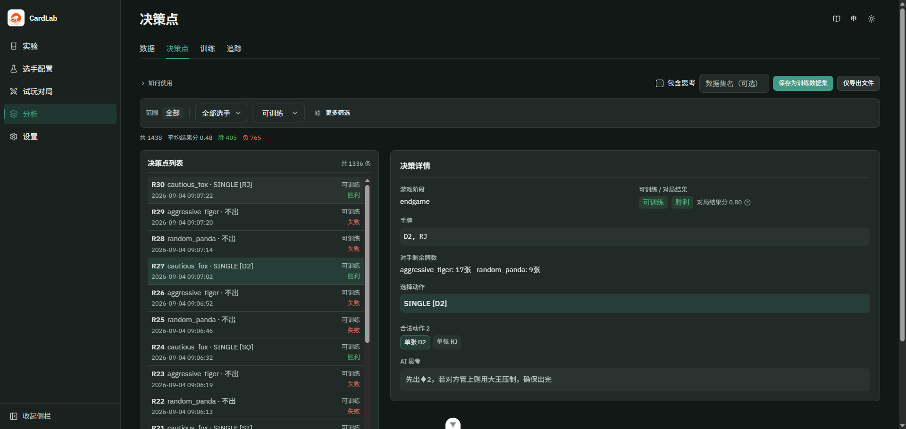
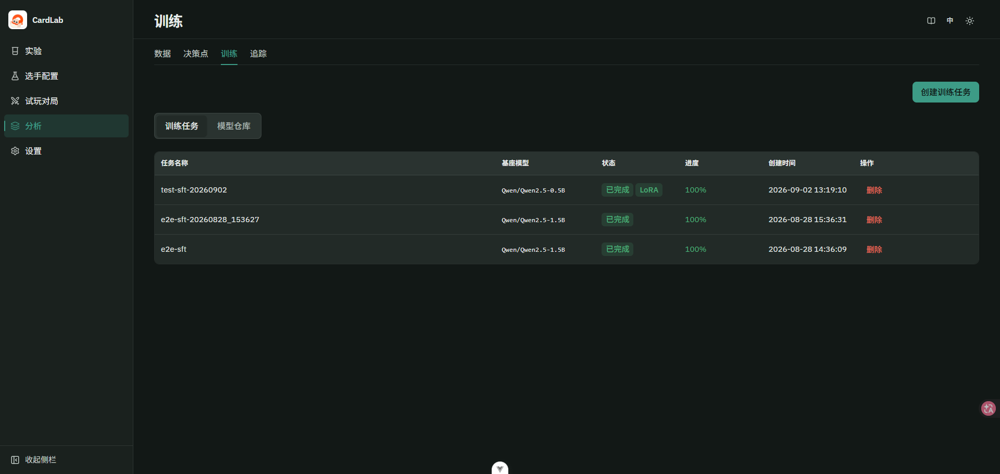
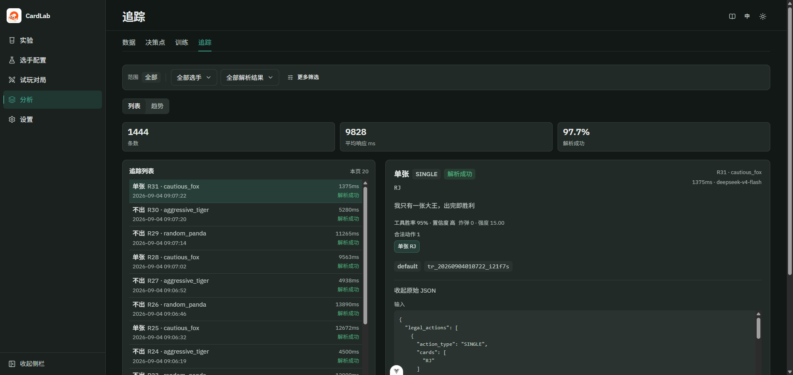

# CardLab

[English](README.en.md) | 中文

本地 AI 卡牌研究工具：以「实验」为主线，提出假设、审查模型决策、比较对局结果并记录结论；LoRA 微调是可选的改进路径。

保存比较快照后，可引用具体决策并按版本记录观察、解释与局限，导出包含快照和所选证据的研究报告。原始决策变化或删除不会改写已保存证据。

> **关于模型与数据**：本项目调用用户配置的模型进行卡牌决策，支持从对局记录导出训练数据，也可从同源发牌中的首次可验证行动分歧导出教师与学生的偏好对。使用第三方模型的输出前，请核对供应商对相应用途的许可。项目本身不附带模型权重。

## 技术栈

Windows 桌面开发版复用同一套研究工作台，随安装包提供 Python 后端。构建、使用范围和验收状态见 [桌面端文档](docs/desktop/README.md)。当前为未签名开发包，尚未完成干净系统发布验收。

桌面端支持 JSON 和可读报告 HTML 的系统另存为，并在成功写入后定位文件。主窗口位置、大小与最大化状态随研究地址一起恢复。现有安装包对应较早的源码。 [报告导出验收](specs/desktop-research-workspace/validation-4a.md) · [文件定位验收](specs/desktop-research-workspace/validation-5d.md) · [布局恢复验收](specs/desktop-research-workspace/validation-5e.md)

研究费用面板支持人工登记、OpenAI 项目费用快照、CSV 对账及新任务限制。金额各自按其来源和覆盖范围统计。真实账单验收及实际支出硬上限仍待完成。 [费用验收流程](specs/desktop-research-workspace/billing-acceptance.md)

| 层级 | 选型 |
|------|------|
| 前端 | Vue 3 · TypeScript · Vite · Tailwind v4 · Reka UI |
| 后端 | Python 3.11+ · FastAPI · WebSocket |
| LLM | OpenAI · Ollama · DashScope · DeepSeek · Kimi · Zhipu · Yi · Baichuan · MiniMax |
| 存储 | SQLite 索引 + JSONL 归档 |
| 训练 | PEFT LoRA（`poetry install --with training`；无 GPU 走 CPU 快速验证；可选 4-bit QLoRA 需自行安装 bitsandbytes） |

## 快速开始

**环境**：Python 3.11+ · Node 20.19+ / 22.12+ · Poetry ·（可选）Ollama

```bash
git clone https://github.com/blueWhalei/ai-card-game-lab.git
cd ai-card-game-lab
cp .env.example .env    # Windows: copy .env.example .env
```

两个终端分别启动：

| 平台 | 后端（:8000） | 前端（:5173） |
|------|---------------|---------------|
| Windows | `scripts\start-backend.bat` | `scripts\start-frontend.bat` |
| macOS / Linux | `chmod +x scripts/*.sh` 后 `./scripts/start-backend.sh` | `./scripts/start-frontend.sh` |

也可手动：`cd server && poetry install && poetry run uvicorn ...` · `cd web && npm install && npm run dev`。

打开 http://localhost:5173 。首次选择「创建实验 → 离线试跑一局 → 创建并进入详情」，再点「开始实验」确认。系统会准备三名本地策略选手，使用一副固定牌实际对局，无需密钥。要使用模型，选择「自选席位」，在同一窗口添加或选择选手，按开局条件补齐密钥、服务地址或模型名称。点击「检查模型连接」只读取所选供应商的模型目录。

源码环境使用项目 `.env`，桌面版使用设置页显示的 `config.env`。修改配置文件后重启服务。「加载演示实验」会写入预制主实验与对照数据，供浏览分析流程。仓库 [`examples/`](examples/) 提供可导入的实验包。

## 主路径

1. **建立研究与配置选手** — 首页记录研究问题，选择模型、策略与采样参数；快速实验自动建立研究。
2. **设计实验** — 在研究工作区创建运行，选择选手，记录假设与判断标准。创建不会自动开局；复制与配对对照沿用所属研究。
3. **运行与审查** — 观战、回放，审查全部决策，包括失败和不符合训练格式要求的记录。“可训练”仅表示结构有效，不代表决策质量。
4. **比较结果** — 比较已有实验，或用已有选手与源实验发牌种子创建对照；解读结果前核对协议差异和有效样本量。
5. **记录结论** — 详情中的实验笔记和工作摘要、比较中的研究结论草稿均自动保存到本地数据库。笔记需点击「应用笔记到实验」更新实验摘要；正式研究结论需在比较快照下引用决策并显式保存新版本，然后导出报告。草稿保存失败时保留输入，支持重试、导出副本和冲突处理。

桌面研究工作室的[整体设计](specs/desktop-research-workspace/design.md)、[需求与验收](specs/desktop-research-workspace/requirements.md)和[分批计划](specs/desktop-research-workspace/tasks.md)区分已实现能力与后续改造。统计方向性判断需配对证据、差值区间、检验及协议审查共同支持；这是当前条件下的探索性判断，不证明普遍优势或等效。

**可选训练：** 从「分析 → 训练」进入数据集登记、微调与选手注册。审查、比较和创建对照均不要求先训练。通过 `?collect=1` 打开对照只显示开始确认，明确提交后才会运行对局。

比较页现可审查冻结协议差异与共同有效种子，重复运行产生的歧义会被排除并列出。声明允许变化的 Solver 字段后重新比较，可保存具名快照，之后重开或导出冻结结果。当前声明属于事后审查；研究报告可附所选证据，完整可运行复现包仍待实现。

首页 `/` 是研究工作室，`/research/:id` 集中显示所属运行与比较记录；未组织运行可手动加入研究。比较只有全部运行均属于同一研究时才列入其记录，跨研究比较仍保留在比较库。研究内的「设计 Prompt A/B」提供选择基线、定义单阶段变更、核对冻结条件三步流程。需要固定发牌且至少有一个模型选手的基线；保存 B 后分别确认运行，再进入已有比较与结论流程。创建不调用模型，配置检查不等于连接已验证。详见 [第二批 B 设计](specs/desktop-research-workspace/batch-2b.md)；联动分析仍在后续计划。

基准测试模式使用固定发牌种子（最多 50 局）；详情页阶段下方给出**本实验**的指标（地主胜率、解析、可训练、延迟、每局 Token）。试玩对局在侧栏 `/game`，不计入实验。决策点、追踪、数据、训练在侧栏「分析」（`/pipeline/…`，支持 `?experiment_id=`）。实验详情可导出 JSON 实验包（包内不含 API 密钥），「全部运行」`/experiments` 可导入以在另一台机器复现。使用说明：顶栏书本图标 `/guide`。

脚本闭环：`.\scripts\e2e_pipeline.ps1 all -Count 1` — 详见 [E2E 指南](docs/E2E_PIPELINE.md)。

## 界面

<table>
  <tr>
    <td width="50%" valign="top">
      
      <p><strong>选手配置</strong> — 为每个座位指定模型与采样；可导入 / 导出选手包，包内不含 API 密钥。</p>
    </td>
    <td width="50%" valign="top">
      
      <p><strong>试玩对局</strong> — 不计入实验的单局；也可加载演示对局先看观战。</p>
    </td>
  </tr>
  <tr>
    <td width="50%" valign="top">
      
      <p><strong>分析 · 数据</strong> — 语料规模、完成情况、地主 / 农民胜负分布。</p>
    </td>
    <td width="50%" valign="top">
      
      <p><strong>分析 · 决策点</strong> — 每步状态、合法行动、思考与是否可训练；可导出 ChatML。</p>
    </td>
  </tr>
  <tr>
    <td width="50%" valign="top">
      
      <p><strong>分析 · 训练</strong> — PEFT LoRA 任务与模型仓库；完成后可登记为选手。</p>
    </td>
    <td width="50%" valign="top">
      
      <p><strong>分析 · 追踪</strong> — 延迟、解析成功率、工具调用与原始 JSON。</p>
    </td>
  </tr>
</table>

## 配置

`.env` 示例（项目根目录）：

```bash
DEEPSEEK_API_KEY=sk-...
DEEPSEEK_BASE_URL=https://api.deepseek.com/v1
# 或 OPENAI_API_KEY / OLLAMA_BASE_URL=http://localhost:11434
```

| provider | model 示例 |
|----------|-------------|
| `openai` | `gpt-4o-mini` |
| `deepseek` | `deepseek-v4-flash` |
| `ollama` | `qwen2.5:7b` |
| `dashscope` | `qwen-plus` |

## 链接

| 地址 | 说明 |
|------|------|
| https://blueWhalei.github.io/ai-card-game-lab/ | 项目页 |
| http://localhost:5173 | 前端 |
| http://localhost:8000/docs | API 文档 |
| http://localhost:8000/api/v1/system/preflight | 开始前检查 |

## 文档

| 文档 | 说明 |
|------|------|
| [E2E 闭环](docs/E2E_PIPELINE.md) | 采集 → 训练 → 部署 |
| [架构](docs/ARCHITECTURE.md) | 分层与核心流程 |
| [API](docs/API_DESIGN.md) | REST + WebSocket |
| [目录结构](docs/PROJECT_STRUCTURE.md) | 模块地图 |
| [编码规范](docs/CODING_STANDARDS.md) | Python / Vue / i18n |
| [开发示例](docs/EXAMPLES.md) | 新引擎 / 供应商 |
| [CLAUDE.md](CLAUDE.md) | Agent 开发入口 |

## License

[MIT](LICENSE)
